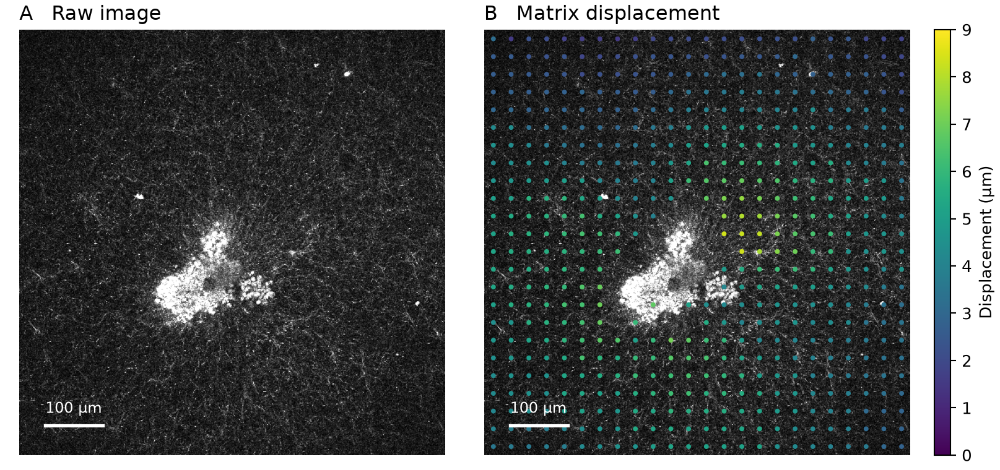

# saenopy MCP

An MCP server that lets an AI assistant run 3D traction force microscopy with [saenopy](https://github.com/rgerum/saenopy). It measures how a cell or organoid deforms the collagen around it, then fits the forces that caused the deformation.



*A: raw organoid image. B: matrix displacement measured through this server. Data: saenopy's public OrganoidTFM example ([methods](examples/organoid/test-run/Supplementary_Methods.md)).*

## Tools

Run them in this order:

| Step | Tool | What it does |
| --- | --- | --- |
| 1 | `estimate_displacement` | Measures the 3D displacement between a relaxed and a deformed z-stack (PIV) and saves a `.saenopy` file. |
| 2 | `reconstruct_forces` | Fits the forces behind that displacement for a material, mesh, and regularization you choose, and saves a new `.saenopy` file. |
| 3 | `export_field` | Writes node coordinates and one field (displacement in m, or force in N) to a CSV. |
| Any | `inspect_result` | Reports what a `.saenopy` file holds and the parameters used. |

Paths must be absolute, and every output needs a new filename: the server never overwrites a file. Give TIFF stacks as templates, with `{z}` for one file per plane or `[z]` for a multipage TIFF. Only saenopy's 3D solver is covered.

## Install

Needs Python 3.10, 3.11, or 3.12.

```bash
uv tool install git+https://github.com/surajinacademia/saenopy_mcp
```

or `pip install git+https://github.com/surajinacademia/saenopy_mcp`. Either puts `saenopy-mcp` on your PATH. If a client cannot find it, use the full path that `which saenopy-mcp` prints.

## Connect

**Claude Code**

```bash
claude mcp add saenopy -- saenopy-mcp
```

**Codex**

```bash
codex mcp add saenopy -- saenopy-mcp
```

A force fit can take several minutes. If Codex stops waiting, add `tool_timeout_sec = 1800` under `[mcp_servers.saenopy]` in `~/.codex/config.toml`.

**Claude Desktop, Cursor, Gemini CLI, and Antigravity** use the same entry:

```json
{
  "mcpServers": {
    "saenopy": { "command": "saenopy-mcp" }
  }
}
```

| Client | Where the entry goes |
| --- | --- |
| Claude Desktop | `~/Library/Application Support/Claude/claude_desktop_config.json` (macOS) or `%APPDATA%\Claude\claude_desktop_config.json` (Windows), then restart the app |
| Cursor | `~/.cursor/mcp.json`, or `.cursor/mcp.json` in a project |
| Gemini CLI | `~/.gemini/settings.json`, or `.gemini/settings.json` in a project |
| Antigravity | Agent panel `…` menu → MCP Servers → Manage MCP Servers → View raw config |

## Examples

These use saenopy's public organoid example: an intestinal organoid in 1.2 mg/mL collagen, imaged as a relaxed stack (frame 6) and a deformed stack (frame 50), 52 planes each, voxel size 1.444 × 1.444 × 1.976 µm. Download it with `scripts/fetch_organoid_example.py` (see below); the settings are the ones saenopy publishes for this sample. Replace `/abs/path` with where you cloned the repository.

**1. Measure the matrix displacement**

> Use saenopy to measure the displacement between the relaxed stack `/abs/path/examples/organoid/raw/4_OrganoidTFM/Pos007_S001_t6_z{z}_ch00.tif` and the deformed stack `.../Pos007_S001_t50_z{z}_ch00.tif`. Voxel size 1.444 × 1.444 × 1.976 µm, 40 µm window, 30 µm spacing, signal-to-noise 1.3, with drift correction. Save it as `/abs/path/run/organoid-piv.saenopy`.

The assistant calls `estimate_displacement`. In the stored run it returned 1,637 finite vectors on 1,728 grid nodes, with a median displacement of 4.4 µm and a maximum of 8.4 µm.

**2. Fit the forces**

> Fit the forces for that result with saenopy's settings for this sample: collagen with stiffness 6062 Pa, buckling strain 0.0025, stiffening strain 0.0804, and stiffening scale 0.034; 30 µm elements on a 738 µm mesh; regularization 1e10, step size 0.33, up to 1,400 iterations, relative convergence 1e-7. Save it as `/abs/path/run/organoid-forces.saenopy`.

The assistant calls `reconstruct_forces` and reports the number of iterations and whether it stopped at the iteration limit. These full settings can run for a long time; the stored test uses a coarser 60 µm mesh of 480 × 480 × 240 µm and 80 iterations so that it finishes in minutes.

**3. Export the result**

> Export the fitted forces to `/abs/path/run/forces.csv`, then tell me what the result file contains.

The assistant calls `export_field` (one row per mesh node: x, y, z in m and the force in N) and `inspect_result`.

## Test with public data

```bash
git clone https://github.com/surajinacademia/saenopy_mcp && cd saenopy_mcp
uv venv --python 3.11 .venv && uv pip install --python .venv/bin/python -e '.[dev]'
.venv/bin/python -m pytest
.venv/bin/python scripts/fetch_organoid_example.py examples/organoid
.venv/bin/python tests/test_public_organoid.py examples/organoid examples/organoid/replay
```

`pytest` checks input handling in about a second. The last command runs all four tools through a real MCP client, in the order above, and compares the displacement with saenopy's published result for the same organoid. The stored run agrees with it to Pearson r = 0.99997 and a per-component RMSE of 0.027 µm over 1,637 nodes; the test also checks that the server refuses to overwrite a file and rejects a missing time point.

## Credits and license

This server is a thin wrapper around [saenopy](https://github.com/rgerum/saenopy), developed by Richard Gerum, David Böhringer, and colleagues. If you publish results, cite saenopy as its repository asks (Böhringer et al., *Nature Physics*, 2024). The organoid example belongs to the saenopy project; it is downloaded for testing, not redistributed here.

The server code is BSD-3-Clause ([LICENSE](LICENSE)). saenopy and its dependencies keep their own licenses; see [THIRD_PARTY_NOTICES.md](THIRD_PARTY_NOTICES.md).
