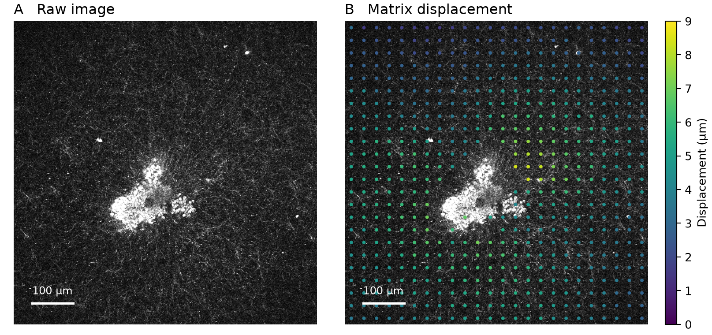

# Supplementary Method S1. Matrix displacement in a public intestinal organoid image pair

One public intestinal organoid sample in 1.2 mg/mL collagen was analyzed using saenopy 1.0.9 through saenopy-mcp 0.1.0 over stdio. The analysis used the 3D solver and compared the estimated displacement field with the evaluated file distributed with the sample. [Raw TIFF stacks](https://github.com/rgerum/saenopy/releases/download/v0.7.4/4_OrganoidTFM.zip) · [Upstream evaluated result](https://github.com/rgerum/saenopy/releases/download/v0.7.4/4_OrganoidTFM_evaluated.zip)

1. **Stack selection.** The reference and deformed volumes were acquired at frame indices 6 and 50 (position 007, channel 00). Each volume comprised 512 × 512 pixels and 52 z-planes. Voxel spacing was 1.444 × 1.444 × 1.976 µm in x, y, and z. All planes were used. No time interval was specified in the evaluated result.
2. **Displacement estimation.** The relaxed and deformed TIFF templates were passed to saenopy's 3D particle image velocimetry (PIV) routine with a 40 µm interrogation window, 30 µm element spacing, a peak-to-peak signal-to-noise threshold of 1.3, and mean drift correction enabled. Displacements were stored in a native result (`organoid-piv.saenopy`) and exported in metres to `piv.csv`.
3. **Comparison with the upstream result.** Node coordinates were matched in native order with an absolute tolerance of 10⁻¹² m. Both fields contained 1,637 finite vectors among 1,728 nodes. The remaining 91 nodes contained nonfinite estimates and were excluded from the comparison. Across the pooled x, y, and z components at jointly finite nodes, Pearson’s correlation was 0.999973 and the root-mean-square difference was 0.02725 µm. The median measured displacement magnitude was 4.435 µm. Reference displacement table (`reference-piv.csv`) · [Comparison values](comparison.json)
4. **Force reconstruction test.** A separate force fit used a 480 × 480 × 240 µm mesh with 60 µm elements. The semi-affine fiber material used a stiffness of 6,062 Pa, a buckling strain scale of 0.0025, a stiffening onset strain of 0.0804, and a stiffening strain scale of 0.034. The regularization parameter was 10¹⁰, the step size 0.33, the relative convergence criterion 0.01, and the iteration limit 80. The saenopy 1.0.9 defaults for regularization method, minimum iteration parameter, and solver precision were Huber, 12, and 10⁻¹⁸. The fit ended after 14 iterations, and the reloaded result (`organoid-force-fit.saenopy`) contained 405 finite nodal force vectors. The coarser mesh and shorter fit were selected to exercise the solver. The reference fit used 30 µm elements on a 738 µm cube and different stopping settings. Quantitative agreement was evaluated for displacement only. Computed force table (`forces.csv`) · Reference force table (`reference-forces.csv`)

## Supplementary Figure S1. Displacement magnitude in the central plane



Panel A shows the raw deformed image at z-index 26 (zero-based) with intensity display limits of 1 and 57. Panel B uses the same image, crop, and grayscale limits. Colored points show the 3D displacement magnitude of the 542 finite nodes in the central PIV plane (z = 0 in centered mesh coordinates). Coordinates follow saenopy’s projection onto the image plane. Color limits were 0–9 µm. White scale bars represent 100 µm.

## Reproduction

From the repository root, fetch the public inputs into `examples/organoid/raw/4_OrganoidTFM` and `examples/organoid/reference`, then run the test and the plot. The replay directory must be new; it receives the native results and CSV tables named above, which are not stored in the repository.

```sh
.venv/bin/python scripts/fetch_organoid_example.py examples/organoid
.venv/bin/python tests/test_public_organoid.py examples/organoid examples/organoid/replay
.venv/bin/python scripts/plot_public_organoid.py examples/organoid examples/organoid/replay
```

The [test script](../../../tests/test_public_organoid.py), [plotting script](../../../scripts/plot_public_organoid.py), [ordered MCP calls and results](calls.json), and [environment versions](environment.txt) identify the executed software and settings. The two final software checks for invalid exports rejected an existing output path and an absent field index. The SHA-256 digests of the downloaded raw and evaluated ZIPs were `20da6febe89e7d95f277ffc0f2db0efba4c180c689266cc0c20c096f9fea4190` and `d896a5f81c29af030f765eb67ea9129d4f5ed9857910250c34f73f096cc313dc`, respectively.
